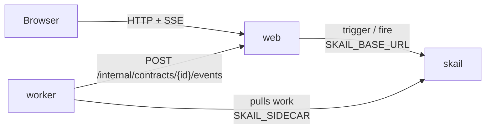

# skail document signing (.NET 8)

[Português (Brasil)](README.pt-BR.md)

A skail function sends a contract to Legal and Finance at the same time and waits for both signatures, in any order, until a deadline. The second signature archives the contract. A refusal cancels it at once, without waiting for the other area, and the deadline expires it; in both cases the signature already given is revoked and the pending request is withdrawn. The deadline is 2 minutes in this demo and days in a real contract, with the same code. A web page sends the contract and has **Sign** and **Refuse** buttons for each area.

The demo covers three topics of the [skail docs](https://docs.skail.dev) (in Portuguese):

- [external events](https://docs.skail.dev/construa/conceitos/eventos-externos-e-correlacao): one event per area, correlated by the contract id;
- the [wait with a deadline](https://docs.skail.dev/construa/como-fazer/esperar-um-evento-com-prazo) pattern: the signatures or the deadline, whichever comes first;
- [human-in-the-loop](https://docs.skail.dev/construa/como-fazer/padroes-e-antipadroes/human-in-the-loop), with two areas deciding in parallel.

## How it works



- **worker** (`src/SkailDocumentSigning.Worker`): the function `SignContract(contractId, title, deadlineSeconds)` in `ContractFunctions.cs` and its commands in `ContractCommands.cs`. `RequestSignature` asks an area to sign; `ArchiveContract`, `CancelContract` and `ExpireContract` end the contract; `ReportStatus` tells the page how the run is going. The commands delegate to `ContractOperations`, so their logic is tested without skail.
- **web** (`src/SkailDocumentSigning.Web`): static page and API. It starts the run (trigger), records each area's decision and sends it to the run (fire), keeps the state in memory and streams it to the page (SSE).
- **contracts** (`src/SkailDocumentSigning.Contracts`): types and constants used by the worker and the web app.

The function only orchestrates and leaves the I/O to the commands. It creates the two waits and the deadline once and uses the same deadline in both `whenAny`, so the two areas share one deadline. `WhenAny` returns the task that finished first, and the function compares it with the waits and the deadline. Simplified from [`ContractFunctions.cs`](src/SkailDocumentSigning.Worker/ContractFunctions.cs), which also reports each stage to the page:

```csharp
await commands.RequestSignature(contractId, title, Areas.Legal);
await commands.RequestSignature(contractId, title, Areas.Finance);
var legal = SkailTask.WaitForEvent<Signature>(Events.LegalSignature, contractId);
var finance = SkailTask.WaitForEvent<Signature>(Events.FinanceSignature, contractId);
var deadline = SkailTask.DelaySeconds((ulong)deadlineSeconds);

var winner = await SkailTask.WhenAny(legal, finance, deadline);
if (winner == deadline)
    return await commands.ExpireContract(contractId, null);

var first = winner == legal ? await legal : await finance;
if (!first.Signed)
    return await commands.CancelContract(contractId, first, otherAlreadySigned: false);

var other = winner == legal ? finance : legal;
if (await SkailTask.WhenAny(other, deadline) == deadline)
    return await commands.ExpireContract(contractId, first);

var second = await other;
if (!second.Signed)
    return await commands.CancelContract(contractId, second, otherAlreadySigned: true);

return await commands.ArchiveContract(contractId, first, second);
```

The function decides by the task that `WhenAny` returned, not by `IsCompleted`: on a resume, `IsCompleted` already sees a signature that arrived after the deadline.

`CancelContract` and `ExpireContract` are the compensation: a signature already given is revoked and a pending request is withdrawn. Both are commands, so if the worker stops in the middle, the run continues from them without asking the areas again.

## The paths

The page has a **Send for signature** button and one card per area, with **Sign** and **Refuse**. The deadline is 2 minutes.

| What you do | What happens | Result |
|---|---|---|
| **Sign** as Finance, then as Legal | archived when the second signature arrives, in any order | **Archived**, with a reference `ARC-…` |
| **Refuse** as Legal | cancelled at once, and the Finance request is withdrawn | **Cancelled** |
| **Sign** as Legal, then **Refuse** as Finance | cancelled, and the Legal signature is revoked | **Cancelled** |
| **Sign** as Finance, then nothing for 2 minutes | the deadline expires the contract: the Finance signature is revoked and the Legal request withdrawn | **Expired** |
| nothing for 2 minutes | both requests are withdrawn | **Expired** |

A second decision from the same area, or a decision after the end, gets `409`. The first decision wins, and no second event is sent. The countdown on the page is only visual: the real deadline is the durable delay in skail, which holds no thread or process.

## How it connects to skail

| Service | Variable | Used for |
|---|---|---|
| worker | `SKAIL_SIDECAR` | Connects the function to your environment and receives its work. |
| web | `SKAIL_BASE_URL` | Starts runs and sends the signatures through the skail HTTP API. |

Both use the same `SKAIL_WORKLOAD`, `SKAIL_NAMESPACE` and `SKAIL_KEY`. The web app makes two calls:

```http
POST {SKAIL_BASE_URL}/api/v1/trigger/{name}/{version}/SignContract/{contractId}
["{contractId}", "Service agreement", 120]

POST {SKAIL_BASE_URL}/api/v1/fire/LEGAL_SIGNATURE/{contractId}
{"Area": "legal", "Signed": true, "By": "Ana", "Reason": null, "At": "2026-11-04T10:00:00+00:00"}
```

The event name comes from the area: `LEGAL_SIGNATURE` or `FINANCE_SIGNATURE`. `{name}` and `{version}` come from `SKAIL_WORKLOAD` (`name:version`). The fire body uses the property names as C# declares them. Each call sends the key in `skail-key` and in `Authorization: Bearer`, plus the `Skail-namespace` header, as described in [authentication](https://docs.skail.dev/referencia/api-http/autenticacao). `429`, `5xx` and network errors are retried with the same contract id. `401` and `403` are not retried: check `SKAIL_KEY` and `SKAIL_NAMESPACE`.

The last number of the trigger is the deadline, in seconds. It is an argument of the function, so it goes into the run history and stays fixed for that run. The web app reads it from `SIGNATURE_DEADLINE_SECONDS` (120 by default); use `604800` for 7 days.

The browser never calls skail. It only talks to the web app, so the key stays on the server.

## Requirements

- .NET 8 SDK
- podman or docker
- PowerShell 7+ (`pwsh`), only if you use `scripts/run.ps1` instead of `scripts/run.sh`
- A skail environment with the workload from `SKAIL_WORKLOAD` registered (`documentsigning:v1.0.0` by default). The [Quickstart](https://docs.skail.dev/comece-aqui/quickstart) shows how to get an account, create the environment and register the workload.
- A current browser (Chrome/Edge 111+, Firefox 113+, Safari 16.2+). The page uses Server-Sent Events, CSS `color-mix()` and modern JavaScript.

## Configure

```bash
cp .env.example .env     # .env holds the key and is ignored by git
```

Fill in `SKAIL_WORKLOAD` (exactly as registered in the portal), `SKAIL_NAMESPACE`, `SKAIL_KEY`, `SKAIL_SIDECAR` and `SKAIL_BASE_URL` with the values of your environment.

The deadline belongs to the web app, so changing it only needs a restart of the web app.

## Run with podman or docker

```bash
scripts/run.sh up        # builds both images and starts web + worker
scripts/run.sh logs
scripts/run.sh down
```

`CONTAINER_ENGINE=docker` forces docker. On Windows, or anywhere with PowerShell 7+, run `pwsh scripts/run.ps1 <command>` with the same commands; `$env:CONTAINER_ENGINE = "docker"` forces docker.

Open <http://localhost:8080> and press **Send for signature**.

### See the durability

Do these steps within the 2-minute deadline.

1. Press **Send for signature**, then **Sign** as Finance. The badge shows **Waiting for Legal**.
2. Run `scripts/run.sh kill-worker`. It kills the worker with SIGKILL, like a crash; the web app keeps the page state.
3. Run `scripts/run.sh start-worker`, then **Sign** as Legal.
4. The contract is **Archived**. The Finance signature from before the crash counts, and no area is asked again.

In the portal, open the [Monitor](https://docs.skail.dev/referencia/portal/monitor) of your environment and search for the contract id. The run lists `ReportStatus`, one `RequestSignature` per area, a `WhenAny` with a `WaitForEvent` and the `Delay` of the deadline, a second `WhenAny` with the `WaitForEvent` of the other area, and the command that ended the contract. The log lines of the commands show up between the steps, such as `Signature requested from Legal: contract …`. The `Delay` shows up once, inside the first `WhenAny`, because the function creates the deadline once and reuses it, and it shows its full duration even when the contract ended earlier. In an archived run, **E2E Duration** was 3.1 s and **Duration** was 622 ms, because the waits do not use the worker. Every path ends as **Completed**, because the function returns normally; its result says how the contract ended (`end: "Expired"`, for example).

## VS Code

Open the folder and accept the recommended extensions (C# Dev Kit).

- `Ctrl+Shift+B` builds, the *test* task runs the tests and the `containers: up/down/logs/kill-worker/start-worker` tasks call `scripts/run.sh`.
- The **Worker + Web** debug configuration starts both projects reading `.env`, and a breakpoint inside a command works. Outside containers, the worker reaches the web app on `localhost` (`WEB_BASE_URL`, set in `launch.json`).

## Tests

```bash
dotnet test
```

The unit tests cover the contracts, the operations behind the commands, the contract store (free order, one decision per area, expiry, undo when the event could not be sent), the calls to skail (trigger, fire and retries) and the web API with SSE. They need neither network nor skail. The function itself runs against skail: the paths above and the durability steps are how to check it.

## Notes

- After a cancellation or an expiry, the waits that did not finish stay without an answer on purpose, and the web app refuses new decisions with `409`. An event sent straight to the skail API does not pass through that check.
- The contract state lives in the memory of the web app. Restarting it loses the page history; the contract keeps running in skail, but the web app ignores the progress of contracts it does not know.
- "Signed by" is free text: there is no authentication, cryptographic signature or real document. The `POST /internal/contracts/{id}/events` route, which the worker calls, has no authentication either. That is fine for a local demo; protect both before using the pattern in production.
- Workers with the same `SKAIL_WORKLOAD` on the same environment share the same runs: use one workload (or environment) per person.

## License

[Apache-2.0](LICENSE)
