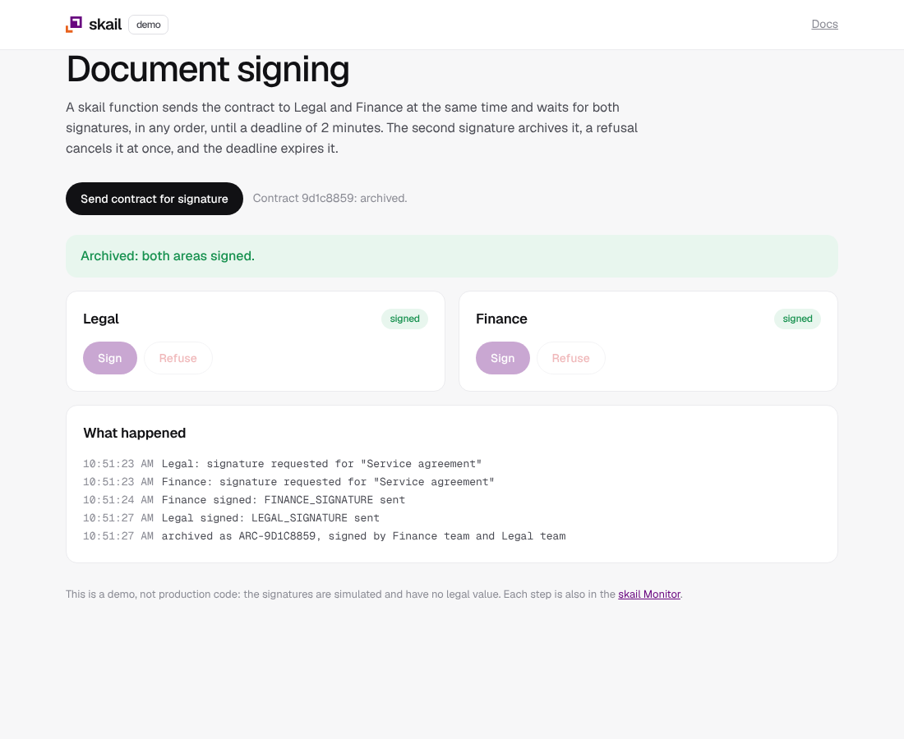

# skail document signing (.NET 8)

[Português (Brasil)](README.pt-BR.md)

An app with a skail function that sends a contract to Legal and Finance at the same time and waits for both signatures, in any order, until a deadline. The second signature archives the contract. A refusal cancels it at once, without waiting for the other area, and the deadline expires it; in both cases the signature already given is revoked and the pending request is withdrawn. You play the two areas on a page the app serves at http://localhost:8080.

It shows three skail features:

- **external events**: one event per area, correlated by the contract id;
- the **wait with a deadline**: the signatures or the deadline, whichever comes first. The deadline is 2 minutes here and days in a real contract, with the same code;
- **durability**: close the app while the contract waits, start it again and the contract goes on, with the signatures already given and the same deadline.

## Requirements

- One of: [Docker](https://docs.docker.com/get-docker/), [Podman](https://podman.io/docs/installation) or the [.NET 8 SDK](https://dotnet.microsoft.com/download/dotnet/8.0) (or newer). The run script uses the first one it finds.
- A skail environment with a workload registered for the `SKAIL_WORKLOAD` in `.env` (`documentsigning:v1.0.0` by default). The [Quickstart](https://docs.skail.dev/comece-aqui/quickstart) shows how to create the account, the environment and the workload.

The project uses `Skail.Platform.Runtime` **2.3.0-rc.4**.

## Run

```bash
cp .env.example .env  # fill in SKAIL_SIDECAR, SKAIL_NAMESPACE and SKAIL_KEY (portal > Environments & keys > Connect)
scripts/run.sh        # then open http://localhost:8080
```

On Windows, in PowerShell: `copy .env.example .env`, then `powershell -ExecutionPolicy Bypass -File scripts\run.ps1` with the same arguments. The script works on the Windows PowerShell built into Windows; PowerShell 7 is not needed.

The script runs the demo with what the machine has: Docker, then Podman, then the .NET SDK. If it finds none of them, it says what to install. Without the script, the commands are `dotnet run` (with the arguments after `--`, as in `dotnet run -- <argument>`).



Each step the commands take shows up on the page, under **What happened**, and in the console. The buttons send the events to the run, and the page refreshes itself every second.

## The paths

| What you click | What happens | Result |
|---|---|---|
| **Send contract for signature**, then **Sign** in both cards, in any order | archived when the second signature arrives | `archived ARC-…` |
| **Refuse** as Legal | cancelled at once, and the Finance request is withdrawn | `cancelled` |
| **Sign** as Legal, then **Refuse** as Finance | cancelled, and the Legal signature is revoked | `cancelled` |
| **Sign** as Finance, then nothing for 2 minutes | the deadline passes: the Finance signature is revoked and the Legal request withdrawn | `expired` |
| nothing for 2 minutes | both requests are withdrawn | `expired` |

## How it works

The app does three jobs in one process: it serves the page, it hosts the worker that runs the function (`builder.UseSkail()`), and it sends the contract and turns the buttons into the signature events, through the skail HTTP API. The commands report each step to a timeline the page shows:

```http
POST {SKAIL_SIDECAR}/api/v1/trigger/documentsigning/v1.0.0/SignContract/{contractId}
["{contractId}", "Service agreement", 120]

POST {SKAIL_SIDECAR}/api/v1/fire/LEGAL_SIGNATURE/{contractId}
{"Area": "legal", "Signed": true, "By": "Legal team", "Reason": null, "At": "2026-11-17T16:02:11Z"}
```

The function, in [`ContractFunctions.cs`](ContractFunctions.cs):

```csharp
[SkailFunction]
public async SkailTask<string> SignContract(string contractId, string title, int deadlineSeconds)
{
    await RequestSignature(contractId, title, Areas.Legal);
    await RequestSignature(contractId, title, Areas.Finance);

    var legal = SkailTask.WaitForEvent<Signature>(Events.LegalSignature, contractId);
    var finance = SkailTask.WaitForEvent<Signature>(Events.FinanceSignature, contractId);
    var deadline = SkailTask.DelaySeconds((ulong)deadlineSeconds);

    var winner = await SkailTask.WhenAny(legal, finance, deadline);
    if (winner == deadline)
        return await ExpireContract(contractId, null);

    var first = winner == legal ? await legal : await finance;
    if (!first.Signed)
        return await CancelContract(contractId, first, otherAlreadySigned: false);

    var other = winner == legal ? finance : legal;
    if (await SkailTask.WhenAny(other, deadline) == deadline)
        return await ExpireContract(contractId, first);

    var second = await other;
    if (!second.Signed)
        return await CancelContract(contractId, second, otherAlreadySigned: true);

    return await ArchiveContract(contractId, first, second);
}
```

- The two waits and the deadline are created once and reused, so both areas share one deadline.
- The function decides by the task `WhenAny` returned, not by `IsCompleted`: on a resume, `IsCompleted` already sees a signature that arrived after the deadline.
- `CancelContract` and `ExpireContract` are the compensation: the signature already given is revoked and the pending request withdrawn. They are commands, so if the app stops in the middle, they do not run twice.
- The commands only print what would happen in the signature and archive systems.

| File | What it has |
|---|---|
| `ContractFunctions.cs` | The function and its commands. |
| `Model.cs` | The areas, the event names and the signature (the payload of the event). |
| `Demo/ContractDesk.cs` | Sends the contract and turns each button into the area's event. |
| `Demo/Timeline.cs` | The timeline of the steps, for the console and the page. |
| `Page/index.html` | The page, with the skail branding. |
| `Skail/SkailApiClient.cs` | Trigger and fire through the skail HTTP API. |
| `Program.cs` | Reads `.env` and the argument, serves the page and its API, and wires everything up. |
| `scripts/run.sh`, `scripts/run.ps1`, `Dockerfile` | Run the demo with Docker, Podman or .NET, whatever the machine has. |

## See the durability

1. Run `scripts/run.sh`, open the page, send a contract and click **Sign** as Finance. The contract waits for Legal.
2. Press **Ctrl+C**. The app closes; the contract stays in skail, with the Finance signature and the deadline.
3. Start the app again with the contract id shown on the page and in the console: `scripts/run.sh <contract id>`. With an id, the app sends no new contract: it only hosts the worker again and follows that contract.
4. Open the page and click **Sign** as Legal. The contract is archived with both signatures. If you wait more than 2 minutes instead, it expires even while the app is closed: the deadline is a durable delay in skail, which holds no thread or process.

In the portal, open the [Monitor](https://docs.skail.dev/referencia/portal/monitor) of your environment and click the run: it lists the two `RequestSignature`, the waits for `LEGAL_SIGNATURE` and `FINANCE_SIGNATURE` with the `Delay` of the deadline, and the command that ended the contract.

## Notes

- Apps running the same `SKAIL_WORKLOAD` on the same environment share the same runs: use one workload (or environment) per person.

## Disclaimer

**This is a demo, not production code.** It exists only to show how [skail](https://docs.skail.dev) works and is provided "as is", without warranty of any kind. The signatures are simulated and have no legal value.

## License

[Apache-2.0](LICENSE)
