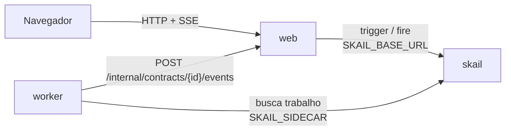

# skail document signing (.NET 8)

[English](README.md)

Uma function do skail manda um contrato para o Jurídico e o Financeiro ao mesmo tempo e espera as duas assinaturas, em qualquer ordem, até um prazo. A segunda assinatura arquiva o contrato. Uma recusa cancela na hora, sem esperar a outra área, e o prazo vencido expira o contrato; nos dois casos a assinatura já dada é revogada e o pedido pendente é retirado. O prazo é de 2 minutos nesta demo e de dias num contrato de verdade, com o mesmo código. Uma página web envia o contrato e tem os botões **Sign** e **Refuse** para cada área.

A demo mostra três tópicos da [documentação do skail](https://docs.skail.dev):

- [eventos externos](https://docs.skail.dev/construa/conceitos/eventos-externos-e-correlacao): um evento por área, correlacionado pelo id do contrato;
- o padrão de [espera com prazo](https://docs.skail.dev/construa/como-fazer/esperar-um-evento-com-prazo): as assinaturas ou o prazo, o que vier primeiro;
- [human-in-the-loop](https://docs.skail.dev/construa/como-fazer/padroes-e-antipadroes/human-in-the-loop), com duas áreas decidindo em paralelo.

## Como funciona



- **worker** (`src/SkailDocumentSigning.Worker`): a function `SignContract(contractId, title, deadlineSeconds)` no `ContractFunctions.cs` e os commands dela no `ContractCommands.cs`. O `RequestSignature` pede a assinatura a uma área; `ArchiveContract`, `CancelContract` e `ExpireContract` encerram o contrato; o `ReportStatus` avisa a página do andamento da execução. Os commands delegam para o `ContractOperations`, então a lógica deles é testada sem o skail.
- **web** (`src/SkailDocumentSigning.Web`): página estática e API. Inicia a execução (trigger), registra a decisão de cada área e manda para a execução (fire), guarda o estado em memória e transmite para a página (SSE).
- **contracts** (`src/SkailDocumentSigning.Contracts`): tipos e constantes usados pelo worker e pelo web.

A function só orquestra e deixa o I/O para os commands. Ela cria as duas esperas e o prazo uma vez só e usa o mesmo prazo nos dois `whenAny`, então as duas áreas dividem um prazo único. O `WhenAny` devolve a task que terminou primeiro, e a function compara essa task com as esperas e o prazo. O trecho abaixo é uma versão simplificada do [`ContractFunctions.cs`](src/SkailDocumentSigning.Worker/ContractFunctions.cs), que também avisa a página de cada etapa:

```csharp
await commands.RequestSignature(contractId, title, Areas.Legal);
await commands.RequestSignature(contractId, title, Areas.Finance);
var legal = SkailTask.WaitForEvent<Signature>(Events.LegalSignature, contractId);
var finance = SkailTask.WaitForEvent<Signature>(Events.FinanceSignature, contractId);
var deadline = SkailTask.DelaySeconds((ulong)deadlineSeconds);

var winner = await SkailTask.WhenAny(legal, finance, deadline);
if (winner == deadline)
    return await commands.ExpireContract(contractId, null);

var first = winner == legal ? await legal : await finance;
if (!first.Signed)
    return await commands.CancelContract(contractId, first, otherAlreadySigned: false);

var other = winner == legal ? finance : legal;
if (await SkailTask.WhenAny(other, deadline) == deadline)
    return await commands.ExpireContract(contractId, first);

var second = await other;
if (!second.Signed)
    return await commands.CancelContract(contractId, second, otherAlreadySigned: true);

return await commands.ArchiveContract(contractId, first, second);
```

A function decide pela task que o `WhenAny` devolveu, não por `IsCompleted`: numa retomada, o `IsCompleted` já enxerga uma assinatura que chegou depois do prazo.

O `CancelContract` e o `ExpireContract` são a compensação: a assinatura já dada é revogada e o pedido pendente é retirado. Os dois são commands, então se o worker parar no meio, a execução continua a partir deles sem pedir de novo às áreas.

## Os caminhos

A página tem o botão **Send for signature** e um card por área, com **Sign** e **Refuse**. O prazo é de 2 minutos.

| O que você faz | O que acontece | Resultado |
|---|---|---|
| **Sign** como Finance, depois como Legal | arquivado quando chega a segunda assinatura, em qualquer ordem | **Archived**, com uma referência `ARC-…` |
| **Refuse** como Legal | cancelado na hora, e o pedido ao Financeiro é retirado | **Cancelled** |
| **Sign** como Legal, depois **Refuse** como Finance | cancelado, e a assinatura do Jurídico é revogada | **Cancelled** |
| **Sign** como Finance e mais nada por 2 minutos | o prazo expira o contrato: a assinatura do Financeiro é revogada e o pedido ao Jurídico é retirado | **Expired** |
| nada por 2 minutos | os dois pedidos são retirados | **Expired** |

Uma segunda decisão da mesma área, ou uma decisão depois do fim, recebe `409`. A primeira decisão vale, e nenhum segundo evento é enviado. A contagem regressiva na página é só visual: o prazo de verdade é o delay durável no skail, que não segura thread nem processo.

## Como conecta ao skail

| Serviço | Variável | Para quê |
|---|---|---|
| worker | `SKAIL_SIDECAR` | Conecta a function ao seu environment e recebe o trabalho dela. |
| web | `SKAIL_BASE_URL` | Inicia execuções e envia as assinaturas pela API HTTP do skail. |

Os dois usam os mesmos `SKAIL_WORKLOAD`, `SKAIL_NAMESPACE` e `SKAIL_KEY`. O web faz duas chamadas:

```http
POST {SKAIL_BASE_URL}/api/v1/trigger/{nome}/{versao}/SignContract/{contractId}
["{contractId}", "Service agreement", 120]

POST {SKAIL_BASE_URL}/api/v1/fire/LEGAL_SIGNATURE/{contractId}
{"Area": "legal", "Signed": true, "By": "Ana", "Reason": null, "At": "2026-11-04T10:00:00+00:00"}
```

O nome do evento vem da área: `LEGAL_SIGNATURE` ou `FINANCE_SIGNATURE`. `{nome}` e `{versao}` vêm de `SKAIL_WORKLOAD` (`nome:versao`). O body do fire usa os nomes das propriedades como o C# declara. Cada chamada manda a chave em `skail-key` e em `Authorization: Bearer`, mais o header `Skail-namespace`, como descrito em [autenticação](https://docs.skail.dev/referencia/api-http/autenticacao). `429`, `5xx` e erros de rede são repetidos com o mesmo id do contrato. `401` e `403` não são repetidos: confira `SKAIL_KEY` e `SKAIL_NAMESPACE`.

O último número do trigger é o prazo, em segundos. Ele é argumento da function, então entra no histórico da execução e fica fixo para aquela execução. O web lê o prazo de `SIGNATURE_DEADLINE_SECONDS` (120 por padrão); use `604800` para 7 dias.

O navegador nunca chama o skail. Ele só fala com o web, então a chave fica no servidor.

## Requisitos

- SDK do .NET 8
- podman ou docker
- PowerShell 7+ (`pwsh`), só se você usar o `scripts/run.ps1` em vez do `scripts/run.sh`
- Um environment do skail com o workload de `SKAIL_WORKLOAD` cadastrado (`documentsigning:v1.0.0` por padrão). O [Quickstart](https://docs.skail.dev/comece-aqui/quickstart) mostra como pedir a conta, criar o environment e cadastrar o workload.
- Um navegador atual (Chrome/Edge 111+, Firefox 113+, Safari 16.2+). A página usa Server-Sent Events, `color-mix()` do CSS e JavaScript moderno.

## Configurar

```bash
cp .env.example .env     # o .env guarda a chave e é ignorado pelo git
```

Preencha `SKAIL_WORKLOAD` (exatamente como está cadastrado no portal), `SKAIL_NAMESPACE`, `SKAIL_KEY`, `SKAIL_SIDECAR` e `SKAIL_BASE_URL` com os valores do seu environment.

O prazo é do web, então mudar o prazo só pede um reinício do web.

## Rodar com podman ou docker

```bash
scripts/run.sh up        # builda as duas imagens e sobe web + worker
scripts/run.sh logs
scripts/run.sh down
```

`CONTAINER_ENGINE=docker` força o docker. No Windows, ou em qualquer sistema com PowerShell 7+, rode `pwsh scripts/run.ps1 <comando>` com os mesmos comandos; `$env:CONTAINER_ENGINE = "docker"` força o docker.

Abra <http://localhost:8080> e clique em **Send for signature**.

### Ver a durabilidade

Faça os passos dentro do prazo de 2 minutos.

1. Clique em **Send for signature** e depois em **Sign** como Finance. O status mostra **Waiting for Legal**.
2. Rode `scripts/run.sh kill-worker`. Ele mata o worker com SIGKILL, como numa queda, e o web mantém o estado da página.
3. Rode `scripts/run.sh start-worker` e clique em **Sign** como Legal.
4. O contrato fica **Archived**. A assinatura do Financeiro de antes da queda vale, e nenhuma área é consultada de novo.

No portal, abra o [Monitor](https://docs.skail.dev/referencia/portal/monitor) do seu environment e procure pelo id do contrato. A execução lista o `ReportStatus`, um `RequestSignature` por área, um `WhenAny` com um `WaitForEvent` e o `Delay` do prazo, um segundo `WhenAny` com o `WaitForEvent` da outra área, e o command que encerrou o contrato. As linhas de log dos commands aparecem entre os passos, como `Signature requested from Legal: contract …`. O `Delay` aparece uma vez só, dentro do primeiro `WhenAny`, porque a function cria o prazo uma vez e reaproveita, e ele aparece com a duração inteira mesmo quando o contrato terminou antes. Numa execução arquivada, o **E2E Duration** foi de 3,1 s e o **Duration** de 622 ms, porque as esperas não ocupam o worker. Todo caminho termina como **Completed**, porque a function retorna normalmente; o resultado dela diz como o contrato terminou (`end: "Expired"`, por exemplo).

## VS Code

Abra a pasta e aceite as extensões recomendadas (C# Dev Kit).

- `Ctrl+Shift+B` compila, a task *test* roda os testes e as tasks `containers: up/down/logs/kill-worker/start-worker` chamam o `scripts/run.sh`.
- A configuração de debug **Worker + Web** sobe os dois projetos lendo o `.env`, e um breakpoint dentro de um command funciona. Fora de container, o worker acessa o web em `localhost` (`WEB_BASE_URL`, definido no `launch.json`).

## Testes

```bash
dotnet test
```

Os testes unitários cobrem os contratos, as operações por trás dos commands, o estado dos contratos (ordem livre, uma decisão por área, expiração, desfazer quando o evento não foi enviado), as chamadas ao skail (trigger, fire e novas tentativas) e a API web com SSE. Eles não precisam de rede nem do skail. A function em si roda contra o skail: os caminhos acima e os passos de durabilidade são a forma de conferir.

## Observações

- Depois de um cancelamento ou de uma expiração, as esperas que não terminaram ficam sem resposta de propósito, e o web recusa novas decisões com `409`. Um evento enviado direto para a API do skail não passa por essa verificação.
- O estado dos contratos fica na memória do web. Reiniciar o web perde o histórico da página; o contrato continua rodando no skail, mas o web ignora o andamento de contratos que ele não conhece.
- "Signed by" é texto livre: não há autenticação, assinatura criptográfica nem documento de verdade. A rota `POST /internal/contracts/{id}/events`, que o worker chama, também não tem autenticação. Para uma demo local isso basta; proteja as duas antes de usar o padrão em produção.
- Workers com o mesmo `SKAIL_WORKLOAD` no mesmo environment dividem as mesmas execuções: use um workload (ou environment) por pessoa.

## Licença

[Apache-2.0](LICENSE)
