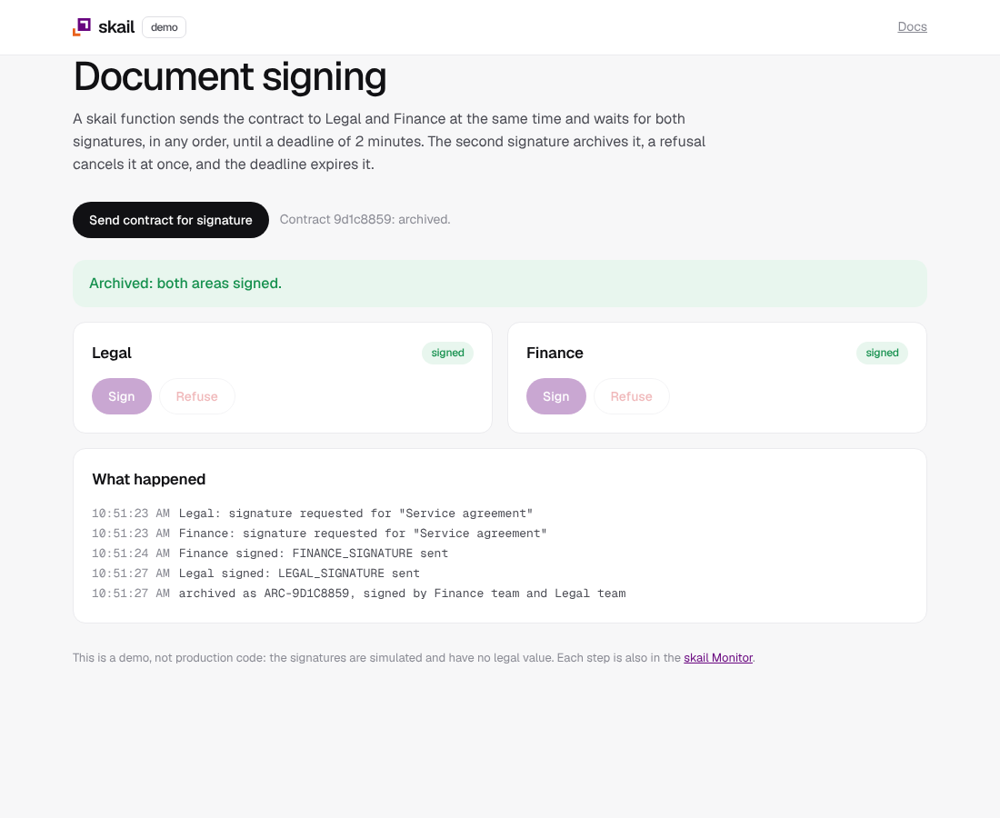

# skail document signing (.NET 8)

[English](README.md)

Um app com uma function do skail que manda um contrato para o Jurídico e o Financeiro ao mesmo tempo e espera as duas assinaturas, em qualquer ordem, até um prazo. A segunda assinatura arquiva o contrato. Uma recusa cancela na hora, sem esperar a outra área, e o prazo expira o contrato; nos dois casos, a assinatura já dada é revogada e o pedido pendente é retirado. Você faz o papel das duas áreas numa página que o app serve em http://localhost:8080.

Ele mostra três recursos do skail:

- **eventos externos**: um evento por área, correlacionado pelo id do contrato;
- a **espera com prazo**: as assinaturas ou o prazo, o que vier primeiro. O prazo é de 2 minutos aqui e de dias num contrato real, com o mesmo código;
- **durabilidade**: feche o app enquanto o contrato espera, abra de novo e o contrato continua, com as assinaturas já dadas e o mesmo prazo.

## Requisitos

- Um destes: [Docker](https://docs.docker.com/get-docker/), [Podman](https://podman.io/docs/installation) ou o [SDK do .NET 8](https://dotnet.microsoft.com/download/dotnet/8.0) (ou mais novo). O script de execução usa o primeiro que encontrar.
- Um environment do skail com um workload registrado para o `SKAIL_WORKLOAD` do `.env` (`documentsigning:v1.0.0` por padrão). O [Quickstart](https://docs.skail.dev/comece-aqui/quickstart) mostra como criar a conta, o environment e o workload.

O projeto usa o `Skail.Platform.Runtime` **2.3.0-rc.4**.

## Rodar

```bash
cp .env.example .env  # preencha SKAIL_SIDECAR, SKAIL_NAMESPACE e SKAIL_KEY (portal > Environments & keys > Connect)
scripts/run.sh        # depois abra http://localhost:8080
```

No Windows, no PowerShell: `copy .env.example .env` e depois `powershell -ExecutionPolicy Bypass -File scripts\run.ps1`, com os mesmos argumentos. O script funciona no Windows PowerShell que já vem no Windows; não precisa do PowerShell 7.

O script roda a demo com o que a máquina tiver: Docker, depois Podman, depois o SDK do .NET. Se não achar nenhum, ele diz o que instalar. Sem o script, os comandos são `dotnet run` (com os argumentos depois de `--`, como em `dotnet run -- <argumento>`).



Você faz o papel do Jurídico e do Financeiro. A página mostra o contrato com uma barra com a contagem do prazo que as duas áreas dividem, e um cartão para cada área com **Sign** e **Refuse** e o que aconteceu com ela: assinado, recusado ou, quando o contrato não vai adiante, revogado ou retirado. Cada botão envia o evento da área para a execução; cada passo também aparece em **What happened** e no console, e a página se atualiza sozinha a cada segundo.

## Os caminhos

| O que você clica | O que acontece | Resultado |
|---|---|---|
| **Send contract for signature**, depois **Sign** nos dois cards, em qualquer ordem | arquivado quando chega a segunda assinatura | `archived ARC-…` |
| **Refuse** no Jurídico (Legal) | cancelado na hora, e o pedido ao Financeiro é retirado | `cancelled` |
| **Sign** no Jurídico, depois **Refuse** no Financeiro (Finance) | cancelado, e a assinatura do Jurídico é revogada | `cancelled` |
| **Sign** no Financeiro, depois nada por 2 minutos | o prazo vence: a assinatura do Financeiro é revogada e o pedido ao Jurídico retirado | `expired` |
| nada por 2 minutos | os dois pedidos são retirados | `expired` |

## Como funciona

O app faz três coisas no mesmo processo: serve a página, hospeda o worker que executa a function (`builder.UseSkail()`) e envia o contrato e transforma os botões nos eventos de assinatura, pela API HTTP do skail. Os commands registram cada passo numa linha do tempo que a página mostra:

```http
POST {SKAIL_SIDECAR}/api/v1/trigger/documentsigning/v1.0.0/SignContract/{contractId}
["{contractId}", "Service agreement", 120]

POST {SKAIL_SIDECAR}/api/v1/fire/LEGAL_SIGNATURE/{contractId}
{"Area": "legal", "Signed": true, "By": "Legal team", "Reason": null, "At": "2026-11-17T16:02:11Z"}
```

A function, em [`ContractFunctions.cs`](ContractFunctions.cs):

```csharp
[SkailFunction]
public async SkailTask<string> SignContract(string contractId, string title, int deadlineSeconds)
{
    await RequestSignature(contractId, title, Areas.Legal);
    await RequestSignature(contractId, title, Areas.Finance);

    var legal = SkailTask.WaitForEvent<Signature>(Events.LegalSignature, contractId);
    var finance = SkailTask.WaitForEvent<Signature>(Events.FinanceSignature, contractId);
    var deadline = SkailTask.DelaySeconds((ulong)deadlineSeconds);

    var winner = await SkailTask.WhenAny(legal, finance, deadline);
    if (winner == deadline)
        return await ExpireContract(contractId, null);

    var first = winner == legal ? await legal : await finance;
    if (!first.Signed)
        return await CancelContract(contractId, first, otherAlreadySigned: false);

    var other = winner == legal ? finance : legal;
    if (await SkailTask.WhenAny(other, deadline) == deadline)
        return await ExpireContract(contractId, first);

    var second = await other;
    if (!second.Signed)
        return await CancelContract(contractId, second, otherAlreadySigned: true);

    return await ArchiveContract(contractId, first, second);
}
```

- As duas esperas e o prazo são criados uma vez e reaproveitados, então as duas áreas dividem o mesmo prazo.
- A function decide pela task que o `WhenAny` devolveu, não pelo `IsCompleted`: numa retomada, o `IsCompleted` já enxerga uma assinatura que chegou depois do prazo.
- O `CancelContract` e o `ExpireContract` são a compensação: a assinatura já dada é revogada e o pedido pendente é retirado. Eles são commands, então, se o app parar no meio, não rodam duas vezes.
- Os commands só imprimem o que aconteceria nos sistemas de assinatura e de arquivo.

| Arquivo | O que tem |
|---|---|
| `ContractFunctions.cs` | A function e os commands dela. |
| `Model.cs` | As áreas, os nomes dos eventos e a assinatura (o payload do evento). |
| `Demo/ContractDesk.cs` | Envia o contrato e transforma cada botão no evento da área. |
| `Demo/Timeline.cs` | A linha do tempo dos passos, para o console e a página. |
| `Page/index.html` | A página, com o branding do skail. |
| `Skail/SkailApiClient.cs` | Trigger e fire pela API HTTP do skail. |
| `Program.cs` | Lê o `.env` e o argumento, serve a página e a API dela e liga tudo. |
| `scripts/run.sh`, `scripts/run.ps1`, `Dockerfile` | Rodam a demo com Docker, Podman ou o .NET, o que houver na máquina. |

## Veja a durabilidade

1. Rode `scripts/run.sh`, abra a página, envie um contrato e clique em **Sign** no Financeiro. O contrato espera o Jurídico.
2. Aperte **Ctrl+C**. O app fecha; o contrato continua no skail, com a assinatura do Financeiro e o prazo.
3. Abra o app de novo com o id do contrato que aparece na página e no console: `scripts/run.sh <id do contrato>`. Com um id, o app não envia outro contrato: só hospeda o worker de novo e acompanha esse contrato.
4. Abra a página e clique em **Sign** no Jurídico. O contrato é arquivado com as duas assinaturas. Se você esperar mais de 2 minutos, ele expira mesmo com o app fechado: o prazo é um delay durável no skail, que não ocupa thread nem processo.

No portal, abra o [Monitor](https://docs.skail.dev/referencia/portal/monitor) do seu environment e clique na execução: ela lista os dois `RequestSignature`, as esperas por `LEGAL_SIGNATURE` e `FINANCE_SIGNATURE` com o `Delay` do prazo, e o command que encerrou o contrato.

## Observações

- Apps rodando o mesmo `SKAIL_WORKLOAD` no mesmo environment dividem as mesmas execuções: use um workload (ou environment) por pessoa.

## Aviso

**Esta é uma demonstração, não é código de produção.** Ela existe só para mostrar como o [skail](https://docs.skail.dev) funciona e é fornecida "como está", sem garantia de nenhum tipo. As assinaturas são simuladas e não têm valor legal.

## Licença

[Apache-2.0](LICENSE)
